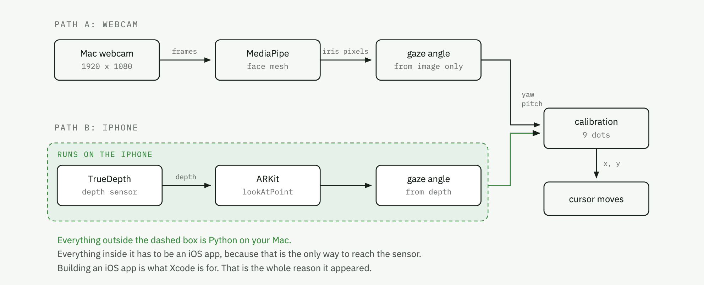

# Playing with ARKit gaze

GazeStreamer app is on the phone, the Python environment exists, and the toolchain is configured. This is just the day to day loop.



## Start it

**1. On the iPhone.** Open **GazeStreamer** and press **Start**.

Check the address field matches your Mac. If your IP has changed, find it with:

```bash
ipconfig getifaddr en0
```

The phone must be on the same network as the Mac. Wi-Fi from the same router is fine; cellular is not.

You should see a green dot and **Face tracked**, with the packet counter rising.

**2. On the Mac.**

```bash
cd ~/Developer/EyeTracker/ARKitGaze
./run.sh
```

A small always-on-top window appears. Within a second it should read `streaming 60 pkt/s` in green.

## Calibrate

Press **Calibrate (9 points)**. The screen goes black and nine red dots appear in
turn. Look at each one and hold until it jumps. Twenty seconds in total.

Keep your head still and let your eyes do the travelling. Do not move the phone
during or after calibration: the fit assumes a fixed phone to screen geometry.

When it finishes you get a line like:

```
fit error 75 px | span 3.0 x 3.2 deg
```

**span** is how many degrees your gaze swept across the whole screen. **fit
error** is how well the nine readings matched the nine dot positions.

| what you see | what it means |
|---|---|
| span 3 deg, error 60 to 100 px | normal for this setup, usable but loose |
| span under 2 deg | says SPAN TOO SMALL, the fit is worthless, redo it |
| error above 200 px | something moved during calibration, redo it |
| span above 7 deg **and** error under 60 px | better than anything achieved so far |

Calibration is saved to `mac/calibration.json` and reloads next launch. Delete
that file to start clean.

## Drive the cursor

Click **Mouse control: OFF** to arm it, then look around the screen.

**To get your mouse back, just move it.** Any physical mouse movement switches
gaze control off instantly. That is the escape hatch; you do not need to reach
the button.

The slider trades lag against jitter. Right is snappier and jumpier, left is
steadier and laggier.

If the status says `gaze off screen, not moving`, the fit is extrapolating past
the range it was calibrated over. Recalibrate.

## What to expect?

Measured over six calibrations: the TrueDepth sensor gives roughly **3 degrees**
of usable gaze swing across the full screen, which works out to about 550 pixels
per degree. Fit error sits between 60 and 100 px before any live jitter.

In practice the cursor lands in the right region of the screen, not on the right
button. This is a limit of the sensor, not of the calibration or the mapping.
`ARFaceAnchor.lookAtPoint` and the raw `leftEyeTransform` / `rightEyeTransform`
were measured against each other and carry identical information, so there is no
better signal available from ARKit.

## When it stops working

**No packets arriving.** Check, in order: the address field on the phone matches
`ipconfig getifaddr en0`; both devices are on the same network; Settings,
Privacy & Security, Local Network has GazeStreamer switched on.

**Cursor does not move at all.** The terminal needs Accessibility permission.
System Settings, Privacy & Security, Accessibility, add your terminal app, then
restart it. Verify with:

```bash
cd ~/Developer/EyeTracker/ARKitGaze
.venv/bin/python -c "
import pyautogui, time
pyautogui.FAILSAFE=False
pyautogui.moveTo(400,300); time.sleep(0.25)
print('works' if pyautogui.position()[:2]==(400,300) else 'blocked')"
```

**Port already in use.** A previous receiver is still running:

```bash
pkill -f mac/gaze_receiver.py
```

**The app will not open on the phone, or disappeared.** A free Apple ID
certificate expires after seven days. Rebuild and reinstall:

```bash
cd ~/Developer/EyeTracker/ARKitGaze/ios
xcodebuild -project GazeStreamer.xcodeproj -scheme GazeStreamer \
  -destination 'id=00008110-001019C03ED8401E' \
  -configuration Debug -allowProvisioningUpdates build

APP=$(xcodebuild -project GazeStreamer.xcodeproj -scheme GazeStreamer \
  -destination 'id=00008110-001019C03ED8401E' -configuration Debug \
  -showBuildSettings 2>/dev/null | awk -F' = ' '/ BUILT_PRODUCTS_DIR/{print $2; exit}')

xcrun devicectl device install app \
  --device 00008110-001019C03ED8401E "$APP/GazeStreamer.app"
```

Your device ID is `00008110-001019C03ED8401E`. Confirm it is connected with
`xcrun devicectl list devices`.

## Rebuilding the Python environment

If `.venv` is ever lost:

```bash
cd ~/Developer/EyeTracker/ARKitGaze
./setup.sh
```

## Changing the Swift

Edit the sources under `ios/GazeStreamer/`, then rebuild and reinstall with the
commands above. If you change `ios/project.yml`, regenerate the project first:

```bash
cd ~/Developer/EyeTracker/ARKitGaze/ios && xcodegen generate
```

The team ID is pinned in `project.yml`, so regenerating keeps your signing setup.
