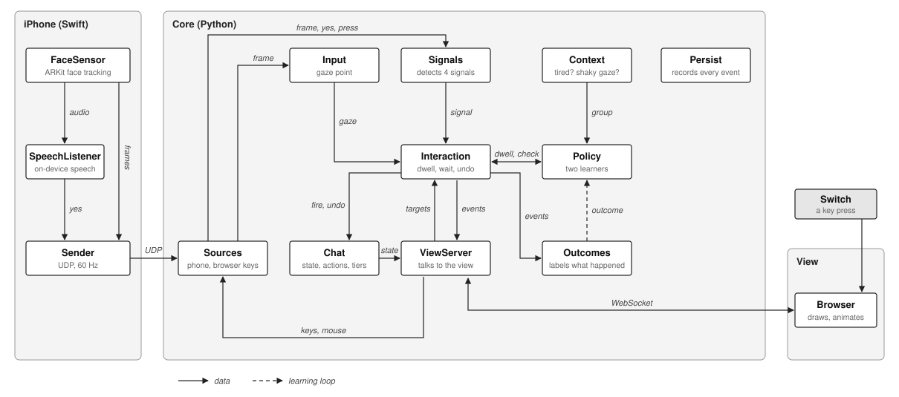

# Communic-aid: High Fidelity Prototype Plan

This plan turns the low fidelity prototype (Report 2) into a working app. People look at buttons to pick them. Risky actions ask for a second signal. The app learns from what each person does, so it gets faster and safer for them over time.

It builds on two things we already have:

1. **ARKitGaze**: the iPhone app that streams gaze from the TrueDepth camera, and the Python calibration code.
2. **router-demo.html**: the dark theme, the button feedback, and the first version of both learners (ported to Python).

All the logic is written in **Python**. The browser only draws.

---

## 1. What we are building

**In scope**

- The 7 screens from the sitemap: Landing, Chat list, Chat thread, Compose, Message actions, Call, Settings.
- The global layer on every screen: gaze dot, undo strip, sidebar, tracking banner.
- Gaze selection with a dwell fill.
- Four second signals from Report 2: **blink and hold**, **raised eyebrows**, **saying "yes"**, **switch press**.
- Two learners: one for **dwell time**, one for **which signal to ask for**.
- A study mode that logs everything and can switch the learners off for comparison.

**Out of scope**

- Real WhatsApp or Gmail. Chats, calls and contacts are simulated inside the app.
- Server, accounts, cloud. Everything runs on one iPhone and one Mac.

**Changes from the low fidelity prototype**

| Low fidelity | High fidelity | Why |
|---|---|---|
| Mouse cursor with noise as gaze | Real ARKit gaze (mouse kept as a test mode) | |
| Keys B and E stand in for blink and eyebrows | Real ARKit eyelid and eyebrow readings | Section 3 |
| Fixed accident costs (1, 2, 4, 8) | Same values as a starting point, tuned as settings | Section 6.6 |
| Dwell learner using large grids | Same idea, six numbers per group | Easier to build and explain. Section 6.4 |
| Logic in JavaScript (demo) | Logic in Python, browser only draws | The team works in Python. Tests with pytest. Section 9 |

---

## 2. The setup

```
 iPhone (fixed below the screen)              Mac
 ┌───────────────────────────┐          ┌──────────────────────────────────┐
 │ GazeStreamer app          │   UDP    │ Core (Python)                    │
 │  ARKit face tracking 60Hz │ ───────► │  calibration, signals, buttons,  │
 │   gaze ray                │          │  learners, chat, logs            │
 │   eyelids and eyebrows    │          │           ▲  │ WebSocket         │
 │   tracking quality        │          │           │  ▼                   │
 │  Speech on device ("yes") │          │ View (browser, full screen)      │
 └───────────────────────────┘          │  draws screens, animates,        │
                                        │  reports button positions, keys  │
                Switch (acts as a key) ─►│                                  │
                                        └──────────────────────────────────┘
```

**Why this split**

- **The phone only senses.**
- **The Python core makes every decision.** One language for all the logic. Tests run with pytest, the learners and calibration use numpy, and the fit in `gaze_receiver.py` is reused.
- **The browser only draws.** CSS gives the demo's dark theme and smooth animations. The view knows no rules and no numbers from sections 4 to 6.
- **No separate bridge.** The core receives the phone's packets and writes log files itself.

**Python sends events, the browser animates.** For example, Python sends "fill Send over 680 ms" and CSS animates it smoothly. Python never sends 60 fill updates a second. Only the gaze dot position is streamed. The core keeps its own timers, and those are what decide when a button fires.

**Speed.** A WebSocket on the same Mac adds about 1 to 2 ms. The Wi-Fi hop from the phone (10 to 20 ms) is the larger delay either way.

**Hardware**

- iPhone with Face ID (X or later). Mount it on a small clamp **centred below the screen**, tilted up at the face, 40 to 60 cm away. Below the screen sees both eyes and both eyebrows evenly. Beside the screen hides part of the far side of the face.
- Mac with Chrome or Safari in full screen. A 24 inch monitor gives more room than a laptop screen, but a laptop works.
- A switch that types a key (most Bluetooth accessibility switches send Space or Enter). Any keyboard key works for testing.
- Phone and Mac on the same Wi-Fi.

**Alternative, later:** run everything on one iPad Pro with Face ID. No network and no phone to screen calibration, but it means rewriting the app in Swift. Not worth it for this prototype.

---

## 3. Reading the body with ARKit

**What detects what.** ARKit's face tracking gives the gaze and 52 face readings called blend shapes, each from 0 (relaxed) to 1 (fully moved) ([Apple's list](https://developer.apple.com/documentation/arkit/arfaceanchor/blendshapes)). Two of our signals come straight from those readings. The other two are not things a camera can see, so they use another Apple framework or a plain key press.

| Signal | Source | Exact readings |
|---|---|---|
| Gaze and dwell | ARKit face tracking | `lookAtPoint`, `leftEyeTransform`, `rightEyeTransform` (already used) |
| Blink and hold | ARKit blend shapes | `eyeBlinkLeft`, `eyeBlinkRight` |
| Raised eyebrows | ARKit blend shapes | `browInnerUp`, `browOuterUpLeft`, `browOuterUpRight` |
| Say "yes" | Apple Speech framework, using the microphone audio that ARKit hands over | the word "yes" |
| Switch press | Key press on the Mac | any key the switch sends |

### 3.1 What the phone sends

Split today's `GazeTracker.swift` into `FaceSensor`, `SpeechListener` and `Sender` (section 9.2). It already sends the gaze ray and both blink values. Add the three eyebrow readings, two more fields and one new message type. The exact shapes in this section and in 9.4 are the contract between the phone and the core.

```json
{ "type": "frame", "seq": 1042, "t": 371.204,
  "dir": [0.02, -0.11, 0.99],
  "blinkL": 0.04, "blinkR": 0.06,
  "browIn": 0.08, "browOutL": 0.05, "browOutR": 0.06,
  "tracked": true, "dist": 0.47 }

{ "type": "yes", "t": 371.880 }
```

- `browIn`, `browOutL`, `browOutR`: `blendShapes[.browInnerUp]`, `[.browOuterUpLeft]`, `[.browOuterUpRight]`.
- `tracked`: `face.isTracked`.
- `dist`: distance from phone to the eyes in metres (length of `eyeMid`, already computed).
- `yes`: sent when speech hears the word (3.5).
- **Keep sending frames when the face is lost**, with `tracked: false`. Today's code sends nothing then. The core needs those frames to notice tracking loss and to keep its timers running.

### 3.2 Gaze

**Calibration runs in the core and shows its dots in the view**, so it is part of onboarding instead of a separate tkinter window. Reuse `features()` and the numpy fit from `gaze_receiver.py` as they are: 9 dots, 1.2 s to settle, 0.8 s to collect, quadratic fit. Show the fit error. Redo if above 100 px.

**Smoothing:** keep the existing moving average (`alpha = 0.3` at 60 Hz). Expose it in the study panel only.

**When the eyes close, freeze the gaze point.** ARKit's gaze swings when the lids come down. If both blink values are above the closed level, hold the last good gaze point and pause every dwell timer (no fill, no drain). Without this, a blink and hold would drag gaze off the button it is meant to confirm.

**Drift correction (small and automatic).** The phone or the head shifts a little over a session. After every selection that is **not** undone, we know where the person was looking: the button centre. Move a global offset 10% of the way from the average gaze point (last 300 ms of the dwell) towards that centre. Cap the offset at 80 px. If it reaches the cap, show "Let's recalibrate" in Settings.

**Expected accuracy.** From the ARKitGaze tests, gaze lands within 60 to 100 px, in the right area but not on a small key. This drives three choices: big targets, the grouped keyboard as default, and text never being a target.

### 3.3 Blink and hold

| Rule | Value |
|---|---|
| Eyes count as closed | both `blinkL` and `blinkR` above the person's closed level (default 0.5) |
| Hold needed | 500 ms (normal blinks last 100 to 400 ms, so they are ignored) |
| Accepted | the moment the hold reaches 500 ms, with a soft tick **sound** (eyes are closed, so they cannot see the tick) |

### 3.4 Raised eyebrows

| Rule | Value |
|---|---|
| Brow level | the average of `browInnerUp`, `browOuterUpLeft` and `browOuterUpRight` |
| Brows count as raised | brow level above the person's raised level (default 0.5) |
| Hold needed | 300 ms |
| Accepted | tick and sound, as soon as the hold is reached |

Use the average of all three readings. Some people lift mostly the inner brows, others the outer ones, and the average works for both.

**Looking up lifts the brows a little.** The undo strip sits at the top of the screen, so the signal check (3.7) records the resting brow level while the person looks at the top of the screen as well as the middle, and uses the higher of the two.

Report 2 notes the camera can miss eyebrows when tracking is poor, so the poor tracking rule (3.8) covers them too.

### 3.5 Saying "yes"

Done on the phone with Apple's Speech framework, fully on device. Audio never leaves the phone. Only the word event is sent.

- Get audio from ARKit itself: `config.providesAudioData = true`, then pass each buffer from `session(_:didOutputAudioSampleBuffer:)` into the speech request. This avoids two parts of the app fighting over the microphone.
- Request settings: `requiresOnDeviceRecognition = true`, `shouldReportPartialResults = true`, `taskHint = .confirmation`, `contextualStrings = ["yes"]`.
- Locale: try `en-IN`. If `supportsOnDeviceRecognition` is false for it, use `en-US`.
- Count how many times "yes" appears in the latest partial result. When the count goes up, send one `yes` event. Restart the request after each "yes" and every 30 s so transcripts stay short.
- Keep the accepted words in a list (default `["yes"]`) so "haan" or "okay" can be added per person later.
- Add `NSMicrophoneUsageDescription` and `NSSpeechRecognitionUsageDescription` to `project.yml`.

The core ignores "yes" unless a button is waiting for it. So people can talk freely.

### 3.6 Switch

Any key press from the switch. The view catches the key and passes it to the core. Ignore key repeat. Three presses within 2 s is the escape (go Home, draft saved).

### 3.7 Signal check (during onboarding)

People differ a lot, and some cannot raise their eyebrows on purpose at all. A short check sets each person's levels and decides which signals they can use.

1. Look at the middle, then the top of the screen, 2 s each, face relaxed. This records the open level for each eye and the resting brow level.
2. "Close both eyes until you hear the tone", 3 times. Closed level = halfway between open and closed values.
3. "Raise your eyebrows until you hear the tone", 3 times. Raised level = halfway between resting and raised values.
4. "Say yes", 3 times.
5. "Press your switch", 3 times. Skipped if they have none.

A signal that works at least 2 out of 3 times is marked **can do**. The others are never asked for. The person can redo the check from Settings.

### 3.8 Tracking quality

Checked every frame over the last 5 s.

| Problem | What happens |
|---|---|
| Face lost more than 300 ms | Cancel any fill or waiting. Hide the gaze dot. Banner: "I can't see your eyes." |
| Face lost in more than 10% of frames | **Poor tracking**: do not ask for blink or eyebrows. Ask for "yes" or switch instead. |
| Distance outside 30 to 70 cm | Banner: "Move a little closer" or "a little further". |

---

## 4. From a look to an action

### 4.1 Which button is being looked at

- Every button gets an invisible margin of 12 px (half the gap between buttons). Gaze inside the margin counts.
- Gaze must sit on a new button for 100 ms before it becomes the current button. This stops flicker at the edges.
- Text, messages and empty space are never targets.
- A **look** starts when a button becomes current and ends when gaze has been off it for 150 ms. Looks under 100 ms are ignored (just passing through).

### 4.2 Life of one button press

```
 idle ──look──► filling ──full──► tier 0 or 1, or router says "dwell only" ──► fires
                  │                tier 2 or 3 and a signal is needed ─────► waiting
                  │                                                           │
          gaze leaves: drains              right signal ─► accepted ─► fires   │
                                           wrong signal ─► icon shakes, keep waiting
                                           4 s pass ─────► timed out, nothing happens
                                           looks at another button 500 ms ─► cancelled
 fires ──► pause 600 ms (all other buttons dim, only Undo works)
       ──► button locked until gaze leaves it
       ──► undo strip shows for 5 s or until the next action
```

| Step | Value |
|---|---|
| Starting dwell | 1500 ms (careful at first; the learner shortens it) |
| Grace before draining | 150 ms |
| Drain speed | twice the fill speed |
| Waiting window | 4 s, the pulse fades as time runs out |
| Pause after a pick | 600 ms |
| Undo window | 5 s, or until the next action |
| Undo strip dwell | 800 ms, fixed, never learned |

Gaze can leave the button while it is waiting. People move their eyes when they blink or speak. Only a clear look at another button cancels it.

A **wrong signal** (another signal the person can do, but not the one asked for) shakes the icon and plays the soft error tone. It is not accepted. This follows Report 2.

---

## 5. Risk tiers

| Tier | Accident cost (starting value, tuned, see 6.6) | Check | Actions |
|---|---|---|---|
| 0 Navigation | 1 | Dwell only (learned) | Open chat, Back, scroll arrows, open keyboard, close keyboard, More, Close, sidebar items |
| 1 Typing | 2 | Dwell only (learned) | Letter groups, letters, Space, Backspace, predictions, quick replies, Mute, settings toggles |
| 2 Sending | 4 | Router picks: dwell only, or dwell plus a signal | Send, React, End call |
| 3 Irreversible | 8 | Always dwell plus a signal. Router picks which. | Call, Delete, Forward |

Every action still has an undo in the prototype (unsend, restore, end call) so mistakes are visible and can be scored. Tier 3 is about the real world cost.

Tier 2 and 3 use a fixed 1000 ms dwell before the signal step. Only tiers 0 and 1 have a learned dwell.

---

## 6. The learning

This is the core of the project.

### 6.1 The loop

```
   context (tier, tired?, shaky gaze?)
              │
              ▼
   learner picks: dwell time, and which signal (if any)
              │
              ▼
   person uses the button
              │
              ▼
   what happened? (worked / gave up / blocked an accident / accident)
              │
              ▼
   score it, using the tier's cost ──► update the learner's tallies
```

No ratings are ever asked for. Everything is read from behaviour.

### 6.2 Reading what happened

This step decides the quality of everything else. Each outcome is fixed only when its window closes. The learner never updates on a guess.

**For a look (dwell learner)**

| Outcome | How we know | Meaning |
|---|---|---|
| Worked | Fired, not undone within 5 s, and for a letter, the next key was not Backspace within 3 s | Meant it, got it |
| Accident | Fired, then undone within 5 s, or a letter followed by Backspace within 3 s | Did not mean it. The glance lasted at least the dwell. |
| Gave up | Left before the fill finished, then looked back at the same button within 2 s | Meant it, but the dwell felt too long |
| Passed by | Left before the fill finished, did not come back within 2 s | A stray glance. We record how long it lasted. |

**For a signal request (router)**

| Outcome | How we know |
|---|---|
| Worked | Right signal given in time, not undone within 5 s |
| Accident | Right signal given, then undone within 5 s |
| Gave up | Timed out, but they tried a wrong signal, closed their eyes for part of a blink and hold, gave the signal late, or came back to the same button within 3 s |
| Blocked an accident | Timed out, no attempt, did not come back |

When the router picks **dwell only** on tier 2, only Worked or Accident can happen.

### 6.3 Context groups

The same person needs different settings when tired or when gaze is shaky. Two yes/no questions give **4 groups**. Each learner keeps separate tallies per group.

| Question | Yes when |
|---|---|
| Tired? | 20 minutes into the session, **or** after 6 pm, **or** 2 or more accidents or give-ups in the last 6 tries |
| Shaky gaze? | Gaze spread during recent looks (average distance from its own centre, last 20 looks) is more than 1.5 times the spread measured during calibration |

Poor tracking is not a group. It is a hard rule (3.8). There is nothing to learn: the camera simply cannot see blinks.

**Borrowing:** a group with too little data of its own (under 30 looks for dwell, under 20 tries for the router) uses the totals of all groups added together. This matters in short study sessions.

### 6.4 Dwell learner (tiers 0 and 1)

**Idea:** learn two habits of this person. Then for each tier, pick the dwell that balances them against that tier's cost.

- **Stray glances:** how long do unintended looks last? Short stray glances mean a short dwell is safe.
- **Patience:** how long will they wait before looking away? Low patience means a long dwell causes give-ups.

**Six numbers per group**

| # | Number | Starts at |
|---|---|---|
| 1 | Intended looks (worked + gave up) | 2 |
| 2 | Unintended looks (accident + passed by) | 2 |
| 3 | Passed-by count | 3 |
| 4 | Stray glance time: passed-by lengths, plus the dwell for each accident | 900 ms |
| 5 | Give-up count | 1 |
| 6 | Waiting time: time before each give-up, plus the dwell for each worked look | 5000 ms |

The starting values mean "stray glances last about 300 ms and people wait about 5 s", a mild guess that real data overrides quickly.

**Updating** (once the outcome is final, dwell `d` was in use)

| Outcome | Change |
|---|---|
| Worked | #1 +1, #6 + d |
| Gave up after t ms | #1 +1, #5 +1, #6 + t |
| Accident | #2 +1, #4 + d |
| Passed by after t ms | #2 +1, #3 +1, #4 + t |

**Choosing a dwell**

1. Draw three values at random around what the numbers say. The fewer the looks, the wider the spread, so the learner keeps trying nearby options while unsure. (This is called Thompson sampling.)
   - share of intended looks `π`: a Beta draw from #1 and #2
   - typical stray glance `g`: #4 divided by a Gamma draw with shape #3
   - typical patience `p`: #6 divided by a Gamma draw with shape #5
2. For every dwell `d` from 800 to 2000 ms (the limits) in 25 ms steps:

```
accident chance   A(d) = e^(-d / g)
give-up chance    G(d) = 1 - e^(-d / p)

score(d) = π × [ (1 - G) × (1 - 0.6 × d_seconds)  -  0.5 × G ]
         - (1 - π) × A × cost
```

   In words: a selection that worked is worth 1, minus a little for every second waited. A give-up costs 0.5. An accident costs the tier's cost.
3. Take the `d` with the best score.

**Keeping it calm.** A dwell that jumps on every look would feel random. So:

- The first 20 **selections** in a group use 1500 ms. Stray glances never count towards this, so the warm-up cannot end just because gaze wandered. The learner still records everything.
- After that, the dwell changes only once per selection, never on a glance. It moves 5% of the way towards the chosen value, but **shorter only very slowly** (at most 10 ms per selection, under 1%) and **longer more readily** (up to 100 ms), because an accident costs more than a little waiting: `dwell = dwell + clip(0.05 × (best - dwell), -10, +100)`.
- From 1500 ms, a run of clean selections brings it to about 1390 ms after 30 selections and 1190 ms after 50.
- Limits: 800 to 2000 ms. It never goes below 800 ms, however well things go.

**Likely next letter (optional, from Report 2).** In Compose, letter groups holding the next letter of the top 3 predicted words get 0.8 times the dwell. Only use this if typing feels slow in the pilot.

**Quick check we ran.** A simulation of the learner's own preference (without the 800 ms floor and the slow-descent limit), 400 looks per case:

| Simulated person | Tier 0 (starting cost 1) | Tier 1 (starting cost 2) |
|---|---|---|
| Rested, steady gaze | about 400 ms | about 680 ms |
| Tired (longer stray glances, less patience) | about 530 ms | about 820 ms |

It moves the right way: longer when tired, longer when mistakes cost more.

**Why not keep the demo's version?** The demo keeps hundreds of grid values per group for the same two habits. This version keeps six numbers, updates by adding, and gives the same behaviour. It is also easy to show in the report.

### 6.5 Signal chooser, the router (tiers 2 and 3)

**Step 1, filter.** Remove options that are not allowed right now.

- Signals switched off in Settings.
- Signals that failed the signal check.
- Blink and eyebrows while tracking is poor.
- **Dwell only** on tier 3.

At least one signal always stays on (Settings will not let you switch off the last one). If poor tracking leaves nothing, tier 3 buttons show "Tracking is poor" and do not fire.

**Step 2, tally.** For each group, tier and option, count the four outcomes.

| Option | Starts at (worked, gave up, blocked, accident) |
|---|---|
| Dwell only (tier 2) | 1, 0, 0, 1 |
| Each signal | 1, 1, 1, 1 |
| The preferred signal from Settings | 3, 1, 1, 1 |

**Step 3, value of each outcome** (`c` is the tier's current accident cost, starting at 4 for tier 2 and 8 for tier 3)

| Outcome | Value |
|---|---|
| Worked, dwell only | +1 |
| Worked, with a signal | +1 - effort |
| Gave up | -0.5 |
| Blocked an accident | +0.15 × c |
| Accident | -c |

`effort = 0.35 + 0.25 × seconds this person usually takes to give this signal` (a running average per signal, starting at 1.2 s). A quick switch press costs less effort than a slow "yes".

**Step 4, pick.** For each remaining option, draw the four chances at random from its tally (a Dirichlet draw: one Gamma draw per count, divided by their total), multiply by the values, add up, and take the highest. Same idea as 6.4: a tally with 3 tries swings a lot and still gets tried, a tally with 50 hardly moves.

**Step 5, learn.** When the outcome is final, add 1 to that cell. Update the signal's average time if it worked.

**Example.** Rekha in the evening, tier 3 Delete. She has switched "yes" off in Settings (Scenario 3), so it is filtered out. Her blink tally in the tired group shows many give-ups (her blinks fail in the evening, as in Scenario 2). Her eyebrow tally shows mostly worked. The router asks for raised eyebrows.

### 6.6 Settings to tune

The accident costs and the other reward values are **settings we expect to change often**, not fixed facts. The starting values come from Report 2.

| Name | Starting value | How often we tune it |
|---|---|---|
| Accident cost, tier 0 | 1 | Often |
| Accident cost, tier 1 | 2 | Often |
| Accident cost, tier 2 | 4 | Often |
| Accident cost, tier 3 | 8 | Often |
| Give-up value | -0.5 | Often |
| Blocked accident value | +0.15 × cost | Often |
| Time penalty on a worked look | 0.6 per second of dwell | Sometimes |
| Signal effort | 0.35 + 0.25 × usual seconds | Sometimes |
| Undo window | 5 s | Rarely |
| Backspace window | 3 s | Rarely |
| Come-back window | 2 s for looks, 3 s for signals | Rarely |
| Warm-up | 20 selections per group at 1500 ms | Rarely |
| Borrowing | under 30 looks (dwell), under 20 tries (router) | Rarely |
| Smoothing | 5% step once per selection: at most 10 ms shorter, up to 100 ms longer | Sometimes |
| Dwell limits | 800 to 2000 ms | Sometimes |

**Where they live.** All in `config.toml` (section 9). The costs and reward values can also be edited from the study panel, so we can change them between pilot sessions without touching code.

**Changing them never wipes learning.** The learners only store what happened: the six numbers for dwell, and the outcome tallies for the router. Costs are applied only at the moment of choosing. So a new cost takes effect on the very next choice, using everything already learned. No retraining and no reset.

**Every choice is logged with the values in use**, so later we know which settings produced which results.

**How to tune them**

1. **In simulation first** (6.8). Try a few cost sets on the simulated people. For each, look at two numbers: accidents per 100 selections, and how often a tier 2 action asks for a signal.
2. **Then in the pilot**, with simple rules:
   - Too many accidents on a tier: raise that tier's cost.
   - Too many signals asked, or too many give-ups: lower the cost, or make the give-up value more negative.
   - Signals blocking real attempts (people come back after a timeout): lower the blocked accident value.
3. **Keep the order** tier 0 ≤ tier 1 ≤ tier 2 ≤ tier 3, so the tiers keep their meaning.
4. **Freeze the values before the study.** Every participant in the study uses the same set, saved with a version name (for example `costs-v3`).

### 6.7 Saving and resetting

- Learner state is saved per person by the core to `data/<person>/learner.json` after every update.
- Changing a setting never resets learning. Switching a signal off hides it but keeps its tally.
- The study panel has "Reset learning" for new participants.

### 6.8 Testing the learners before people do

Port the simulated people from router-demo.html (Rekha, Arjun, Farhan) into `tests/simulate.py`. Run 500 simulated tries per person and check:

- Dwell moves towards the best value for each case and settles.
- The router stops asking a signal the simulated person is bad at.
- Accidents per 100 tries go down compared with fixed settings.

---

## 7. Screens

The app is designed as a 1280 × 860 frame and scaled as one piece to fill the screen height with the same aspect ratio, centred with a 16 px margin; calibration and the gaze dot still use the whole screen. Undo strip on top (80 px), hidden during setup. Sidebar on the left (Chats, Settings, well apart), hidden in Compose. Buttons at least 120 px tall with 24 px gaps (36 px between keyboard keys). The draft field and Send share their row 3 to 1. The keyboard takes all the height left over. Controls stay in the same place on every screen.

| Screen | What is on it | Tiers |
|---|---|---|
| **1. Landing** (first time only) | a) Calibration, 9 dots. b) About you: age, disability, apps used (all optional, picked by dwell). c) Signal check (3.7) and sound preview. d) Continue. | 0 |
| **2. Chat list** | One large row per chat (Priya, Project group, Dr. Mehta). Up and down arrows if more. | Open chat 0 |
| **3. Chat thread** | Top: Back, name, **Call**. Middle: the latest 4 messages (not targets), the latest three with a small **More** button inside the bubble. Scroll up and down in a right sidebar, always in the same place (faint, and not a target, when there is nothing to scroll). Bottom: draft field (opens Compose), **Send**. | Back 0, More 0, Call 3, Send 2 |
| **4. Compose** | Top: Close keyboard, draft, **Send**. Suggestions row: quick replies when the draft is empty ("I am fine", "Call later", "Hi", "Ok", "Thanks"), word predictions once typing starts. Keyboard. Backspace and Space. | Close 0, keys 1, Send 2 |
| **5. Message actions** | Close nearest to the message. React, Forward, **Delete** furthest from Close. | Close 0, React 2, Forward 3, Delete 3 |
| **6. Call** | "Calling Priya", ringing tone, then a timer after 3 s. Mute, **End call**. | Mute 1, End 2 |
| **7. Settings** | Signals on and off (4 toggles, last one locked on). Preferred signal. Sounds on and off. Keyboard: Grouped or QWERTY. Recalibrate. Check my signals again. | 1 |

**Keyboard.** Default is **Grouped**: 8 group keys (ABC, DEF, GHI, JKL, MNO, PQRS, TUV, WXYZ), then the 3 or 4 letters of the chosen group as large keys. Two looks per letter, but each target is big enough for ARKit's accuracy. QWERTY stays available in Settings for anyone whose calibration error is under 40 px, and for the comparison in Report 2.

**Predictions.** A list of common English words (about 5,000, with counts), matched on the typed start of the word, top 3 by count. Words this person has typed before move up. No AI model needed.

**Forward** opens a contact picker. The tier 3 check happens on the contact chosen.

**After Send**, Priya replies with a scripted message after a few seconds so the chat feels alive.

**Study panel** (hidden, opened with a key): participant ID, condition (Adaptive or Fixed), accident costs and reward values (6.6), reset learning, export logs, smoothing slider. **Debug overlay** (key D): current group, current dwell per tier, last router choice with its drawn scores. Useful for demos, hidden from participants.

**Test mode:** the mouse acts as gaze (with optional noise), keys B (hold), E, Y, S act as the four signals. Same as the low fidelity prototype. The view sends the mouse position and keys to the core, which turns them into the same frames the phone sends. Lets the team build screens without the phone.

---

## 8. Visual design

Dark theme taken from router-demo.html. Dark is the only theme.

```css
:root {
  --bg: #1C1E22;          /* page */
  --screen: #212429;      /* button fill */
  --soft: #25282D;        /* message bubbles, undo strip at rest */
  --line: #30333A;
  --line-strong: #474B53;
  --ink: #E9E7E3;         /* text, tier 0 and 1 outline */
  --muted: #A2A6AD;
  --learn: #93A5FF;       /* dwell fill, at 30% */
  --gaze: #FF6597;        /* gaze dot */
  --ok: #63C18F;          /* accepted */
  --warn: #E3A546;        /* tier 2 outline */
  --risk: #EF7268;        /* tier 3 outline, accident */
  --save: #5FC0C0;        /* undo strip */
  --none: #6E737B;        /* dimmed, unavailable */
}
```

**Colour only where it means something.** Outline colour shows the tier. Blue fill shows dwell. Pink dot shows gaze. Green means accepted. Teal means undo.

**Type.** Atkinson Hyperlegible Next (made for low vision readers). Only three sizes: 18 px for notes and small labels, 22 px for messages and buttons, 28 px for titles. Weight 600 on buttons.

**Buttons.** 10 px corners, 2 px outline in the tier colour. Signal icons: closed eye (blink and hold), raised eyebrows, speech bubble with "yes", round switch. Reuse the demo's SVG icons for all four.

**Motion** (all from the demo)

| State | Look |
|---|---|
| Gaze | Soft pink dot, shrinks while a button is waiting or locked |
| Dwell | Blue circle grows from the centre, drains if gaze leaves |
| Waiting | Label fades, signal icon appears, button breathes in its tier colour (1.8 s cycle) |
| Wrong signal | Icon shakes sideways (0.38 s) |
| Accepted | Glow brightens, tick appears |
| Pause after a pick | Everything except Undo dims |
| Undo strip | Flashes once when it appears |

**Sounds** (one switch turns them all off): soft tick when accepted, softer low tone for a wrong signal, chime when sent, ringing on a call.

Nothing flashes or moves except to give feedback. Calm first.

---

## 9. Architecture: modules and how they connect

### 9.1 Five rules

1. **One job per module.** If describing it needs "and", split it.
2. **Modules never import each other.** They talk through the event bus, or through an interface they are handed. The one exception is `common.py` (bus, clock, shared data classes), which every module may import. Only `__main__.py` imports every module, and its only job is to connect them.
3. **Logic does no input or output.** Only `sources.py`, `view_server.py` and `persist.py` touch the network or the disk. Signals, Interaction, Outcomes, Context, Policy and Chat are plain Python that tests can call directly. The view, in turn, holds no rules: it draws what it is told and reports what it sees.
4. **Time and randomness are passed in.** Modules ask `clock.now()` and use a seeded random generator handed to them. Tests can then replay a session exactly.
5. **Messages between programs follow a written contract**: sections 3.1 (phone to core) and 9.4 (core to view) of this plan, version 1. Change the contract first, then the code on both sides.

### 9.2 The components



*Figure 1. System architecture. The iPhone only senses, the Python core makes every decision, and the browser view only draws. The dashed arrow closes the learning loop: Interaction reports what happened, Outcomes labels it, and Policy learns from it. Context passes the person's current group to Policy. Persist records every event on the bus. `__main__.py`, which connects the modules, is not shown.*

**Phone (Swift).** Senses only. No decisions.

| Component | One job | Gets | Gives | Must not know about |
|---|---|---|---|---|
| `FaceSensor` | Run ARKit, read gaze, 5 blend shapes, tracking, distance | ARKit frames | a face sample | network, UI |
| `SpeechListener` | Hear "yes", on device | audio from FaceSensor | a yes event | network, ARKit |
| `Sender` | Send to the Mac in the contract format | samples, yes events | UDP packets | ARKit, speech |
| `ContentView` | Start, stop, address, status | | | |

**Core (Python).** Makes every decision.

| Module | One job | Gets | Gives | Must not know about |
|---|---|---|---|---|
| Sources | Turn incoming data into bus events: the phone's UDP packets, and keys (plus the mouse in test mode) from the view. | UDP packets, view messages | `frame`, `yes`, `press` | what the readings mean |
| Input | Turn frames into a gaze point (calibration, smoothing, drift, freeze when eyes close) | `frame` | `gaze` | buttons, learning |
| Signals | Detect the four signals, run the signal check | `frame`, `yes`, `press`, `settings` | `signal` | buttons, what is being asked |
| Interaction | The life of one button press (section 4.2) | `gaze`, `signal`, `targets`, `context`, the policy | `look`, `fire`, `wait`, `accept`, `wrong`, `timeout`, `undo` | what buttons do, chats, learning maths |
| Policy | Choose dwell and check, and learn | questions from Interaction, `outcome` | answers | sensors, chats, the view |
| Outcomes | Label what happened (section 6.2) | interaction events | `outcome` | how learning works |
| Context | Work out the group (6.3) and tracking quality (3.8) | `frame`, `gaze`, `outcome` | `context` | buttons |
| Chat | Chats, messages, draft, settings, and the action list | `fire`, `undo` | `state`, `settings` | gaze, signals, learning |
| ViewServer | Serve the view and pass messages both ways | `state`, `gaze`, interaction events | view messages, `targets` | any rule or number from sections 4 to 6 |
| Persist | Write logs, save and load learner state and settings | every event | files in `data/<person>/` | the meaning of events |

**View (browser).** Draws only.

| File | One job |
|---|---|
| `index.html` | The page shell and the researcher panels |
| `view.js` | The 7 screens as small render functions, icons inline. Also keeps the WebSocket open, turns button events into CSS classes and sounds, reports button positions after every redraw and forwards key presses |
| `style.css` | Dark theme and every animation (section 8) |

### 9.3 The interfaces

**Sources.** The phone and the browser look the same to the rest of the core.

```python
@dataclass
class Frame:
    t: float
    dir: tuple[float, float, float] | None   # gaze ray from ARKit
    point: tuple[float, float] | None        # screen point from the mouse (test mode)
    blink_l: float
    blink_r: float
    brow_in: float
    brow_out_l: float
    brow_out_r: float
    tracked: bool
    dist: float

class Source(Protocol):
    def start(self, bus: Bus) -> None: ...   # publishes "frame", "yes", "press"
    def stop(self) -> None: ...
```

In test mode `sources.py` builds frames from the mouse position and turns held keys into fake readings: B sets both blink values to 1, E sets the brow values to 1, Y publishes `yes`. So test mode runs the real signal detection, not a shortcut. The switch key publishes `press` in both modes.

**Policy.** The adaptive learner and the fixed study baseline have exactly these methods.

```python
class Policy(Protocol):
    def dwell_for(self, tier: int, group: str) -> int: ...                     # milliseconds
    def check_for(self, tier: int, group: str, allowed: list[str]) -> str: ... # "dwell", "blink", "brows", "yes" or "switch"
    def learn(self, outcome: Outcome) -> None: ...                             # once an outcome is final
    def save(self) -> dict: ...                                                # plain JSON
    def load(self, saved: dict) -> None: ...
```

**Actions.** The single place where tiers live.

```python
ACTIONS = {
    "send":   Action(tier=2, run=send_message,   undo=unsend_message),
    "delete": Action(tier=3, run=delete_message, undo=restore_message),
    ...
}
```

Screens only mark buttons with the action name: `<button data-action="send">Send</button>`. After every redraw `view.js` measures each `[data-action]` element and sends the list to the core. Interaction looks up the tier in `ACTIONS`. To move an action to another tier, change one line.

### 9.4 Messages between core and view

| Direction | Message | Carries | When |
|---|---|---|---|
| Core to view | `state` | current screen, chats, draft, settings | after any change |
| Core to view | `gaze` | `{x, y}`, or nothing when not valid | every frame (the dot only) |
| Core to view | `button` | `{action, do, ms, check}`, where `do` is fill, drain, wait, accept, wrong, timeout, lock or unlock | only when something changes |
| Core to view | `dim` | on or off, which buttons stay active | pause after a pick |
| Core to view | `sound`, `banner`, `calib_dot` | sound name, banner text, dot position | when needed |
| View to core | `targets` | `[{action, x, y, w, h}]` | after every redraw and window resize |
| View to core | `key` | `{key, down}` | every key press and release |
| View to core | `mouse` | `{x, y}` | test mode only |

### 9.5 Events on the bus (inside the core)

| Event | Sent by | Carries | Used by |
|---|---|---|---|
| `frame` | Sources | raw readings | Input, Signals, Context |
| `yes` | Sources | `{t}` | Signals |
| `press` | Sources | `{t}` | Signals |
| `gaze` | Input | `{t, x, y}`, or nothing when not valid | Interaction, Context, ViewServer |
| `signal` | Signals | `{t, kind}` | Interaction |
| `targets` | ViewServer | `[{action, rect}]` | Interaction |
| `context` | Context | `{group, poor_tracking}` | Interaction |
| `look` | Interaction | `{action, start, end, filled}` | Outcomes, Context |
| `wait`, `accept`, `wrong`, `timeout` | Interaction | `{action, check}` | ViewServer, Outcomes |
| `fire` | Interaction | `{action, tier, dwell, check, signal_time}` | Chat, ViewServer, Outcomes |
| `undo` | Interaction | `{action}` | Chat, Outcomes |
| `outcome` | Outcomes | `{kind, action, tier, group, dwell, check}` | Policy, Context |
| `state` | Chat | the app state | ViewServer |
| `settings` | Chat (Settings screen) | signals on or off, preferred, sounds, keyboard | Signals, Interaction |

Persist listens to every event and logs it. Nothing listens to Persist.

**One loop, one thread.** Everything runs in a single `asyncio` loop. Each frame from the phone drives one pass: Input, then Signals, then Interaction. The time windows (undo, waiting, come-back) are checked on each pass, so no extra threads or timers are needed. If frames stop arriving, a slow backup tick (20 per second) keeps the windows closing.

### 9.6 Folder layout

One file per module. No folders inside the core.

```
communic-aid-hci/
  pyproject.toml            Python 3.11+, numpy, aiohttp, pytest
  config.toml               every number in this plan
  communicaid/              the core
    __main__.py             starts the app and connects the modules
    common.py               bus, clock, shared data classes
    sources.py              phone (UDP) and browser (keys, mouse)
    gaze.py                 the Input module: calibration, smoothing, drift
    signals.py              the four signals and the signal check
    interaction.py
    outcomes.py
    context.py
    policy.py               adaptive (dwell learner and router) and fixed
    chat.py                 app state and the action list with tiers
    chats.json              simulated contacts and messages
    words.txt               word list for predictions
    view_server.py          serves the view and the WebSocket
    persist.py              logs and saved state
  view/
    index.html              page shell and researcher panels
    style.css
    view.js                 the 7 screens, connection, feedback, sounds
  tests/                    one test file per module, plus simulate.py
  ARKitGaze/                phone app, where it is today
  figures/
  data/                     created when the app runs, one folder per person
```

**Run it:** `python -m communicaid --person P01`, then open `http://localhost:8080` in full screen. Add `--source mouse` to work without the phone.

**Where things went:**
- **No subfolders in the core.** Each module is one file. A file can grow to a few hundred lines before it needs splitting.
- **`common.py` is the only file every module may import.** It holds the bus, the clock and the shared data classes (`Frame`, `Outcome`, `Action`), so modules still never import each other.
- **`__main__.py` does the wiring**, so there is no separate `main.py`.
- **The message contract lives in this plan** (3.1 and 9.4) instead of its own folder.
- **The screens are small render functions in `view.js`** with the icons inline. Sounds are short tones made in `view.js`, so there are no `icons/` or `sounds/` folders.
- **One server:** `aiohttp` serves the view and the WebSocket on one port.

### 9.7 What the separation buys us

| Need | Change |
|---|---|
| Fixed vs Adaptive condition | `__main__.py` passes `FixedPolicy` or `AdaptivePolicy`. Nothing else changes. |
| Work without the phone | `--source mouse`. |
| Tune costs | `config.toml` or the study panel. Policy reads them at choice time. |
| Move an action to another tier | One line in `chat.py`. |
| Add a signal later | Signals, the signal check, one icon. |
| Swap the keyboard | One render function in `view.js` and the key list in `chat.py`. |
| Change the look | `style.css` only. |

### 9.8 Testing each module alone (pytest)

| Module | Test |
|---|---|
| Signals | Feed recorded frames, expect signals at the right times and none during normal blinking or reading. |
| Interaction | Fake gaze and a fake policy, expect fills, waits, timeouts, locks as in 4.2. |
| Outcomes | Each row of the tables in 6.2 becomes one test: an event sequence in, the expected label out. |
| Policy | Simulated people (6.8). |
| Whole core | Persist can save raw frames. Replay a recorded session through the core with a fake clock and check the outcomes match. No phone or browser needed. |

---

## 10. Logging

One line of JSON per event, appended by Persist to `data/<person>/events.jsonl`.

```json
{"t": 371.88, "session": "s3", "condition": "adaptive", "screen": "thread",
 "event": "outcome", "target": "send", "tier": 2, "group": "tired+steady",
 "option": "blink", "dwell": 1000, "outcome": "worked", "signal_time": 0.9,
 "costs": "costs-v3"}
```

Events: look start and end, fill complete, waiting start, signal (which one), wrong signal, timeout, fire, undo, outcome, learner choice (with the drawn scores), group change, tracking lost, calibration result. Message text is not logged. Raw 60 Hz frames go to a separate file, only when switched on.

---

## 11. Build order

Each step ends with something we can try.

| Step | Build | Done when |
|---|---|---|
| 1 | Write `common.py` (bus, clock, data classes) and a bare `__main__.py`. Phone sends the new fields and "yes". Core receives them. View shows a gaze dot. | Dot follows the eyes with no visible lag. "yes" is printed by the core. |
| 2 | Calibration (core runs it, view shows the dots), button positions from the view, dwell fill at a fixed 1000 ms, on a test grid of big buttons. | 9 of 10 picks land on the intended button. |
| 3 | Signals and the signal check. | Each signal works 9 of 10 times, and fires falsely at most once in 2 minutes of normal reading. |
| 4 | All 7 screens, tiers, waiting, pause, lock, undo, fixed rules only. | The 6 flow strips from Report 2 can be done end to end. |
| 5 | Outcome reading and logging. | A recorded session's outcomes match what the tester noted by hand. |
| 6 | Learners, borrowing, debug overlay, simulated people test (6.8). | Simulation checks pass. Dwell visibly changes in a real 15 minute session. |
| 7 | Pilot with 2 or 3 team members or friends, fix, then the study. | |

---

## 12. Testing with people

**Who.** First a pilot with able-bodied people, only to find bugs. Then the people from our interviews and any other motor-impaired users we can reach. Report the two groups separately. Report 1 points out that results from able-bodied people do not carry over.

**Design.** Each person uses two versions, in a balanced order:

- **Fixed:** 1000 ms dwell everywhere. Tier 2 dwell only. Tier 3 always their preferred signal.
- **Adaptive:** both learners on.

Two sessions of about 25 minutes. The learner keeps what it learned between sessions of the same person.

**Tasks.** The four scenarios and six flow strips from Report 2: open a chat, compose and send, quick reply, type with Backspace, call with a signal, delete with a signal, change a signal in Settings, recover from a frozen screen.

**Measures**

| What | How |
|---|---|
| Speed | Task time, characters per minute |
| Mistakes | Accidents per 100 selections, undos |
| Effort | Give-ups, signals asked per tier 2 action |
| Experience | SUS (usability) and NASA-TLX (workload) after each version |
| Their words | 5 minute interview: what felt slow, what felt unsafe, which signal they liked |

This also answers Research Question 3 from Report 1: is the extra effort of a second signal worth the accidents it prevents?

---

## 13. Risks and fallbacks

| Risk | Fallback |
|---|---|
| Gaze too coarse for some people | Grouped keyboard. Bigger layout option. Drift correction. Recalibrate from Settings. |
| Phone gets bumped | Calibration breaks. Clamp it firmly. Drift correction flags it. |
| Some people cannot raise their eyebrows on purpose | The signal check filters it out per person. |
| Looking up at the undo strip lifts the brows | Resting brow level is measured while looking at the top of the screen. |
| "yes" heard by mistake | Only counts while a button is waiting. |
| Slurred speech (Participant 1) | The signal check marks "yes" as unusable. Switch or blink instead. |
| A very hard signal looks like "blocked an accident" when people give up without returning | Partial attempts (a short eye closure, a wrong signal) count as intent, so these become "gave up". |
| Too little data per person in a short study | Borrowing across groups. Learning carries over between sessions. |
| Glasses or bright sunlight weaken eyelid readings | Poor tracking rule switches to "yes" or switch. |

---

## 14. Privacy

Everything stays on the phone and the Mac. Audio never leaves the phone. Logs use participant IDs, not names, and contain no message text.
