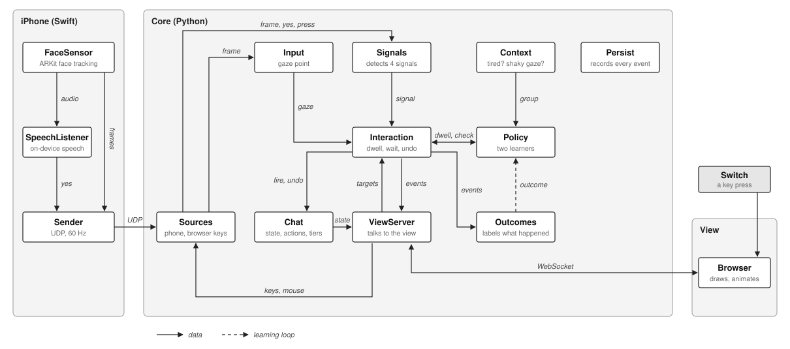

# Communic-aid

A hands-free messaging app for people with motor impairments. You select buttons by looking at
them, and risky actions (send, call, delete) ask for a second signal: blink and hold, raised
eyebrows, saying "go", or a switch. Two learners adapt the dwell time and the signal to each person.



An iPhone senses, a Python core on the computer makes every decision, and the browser draws.

## Requirements

- A Mac with Python 3.11 or newer, or [uv](https://docs.astral.sh/uv/)
- For gaze: an iPhone with Face ID, Xcode to install the phone app, and both devices on the same Wi-Fi

## Setup

```bash
./setup.sh
```

This creates `.venv` and installs the app. `./setup.sh --test` also runs the tests.

## Run without the phone

```bash
.venv/bin/python -m communicaid --person P01 --source mouse
```

Open http://localhost:8080 and click to start. The mouse acts as your gaze.

| Key | Signal |
|---|---|
| Hold B | Blink and hold |
| Hold E | Raise eyebrows |
| Y | Say "go" |
| S or Space | Switch |
| Esc | Home |

## Run with the iPhone

1. Install the GazeStreamer app from `ARKitGaze/ios` (see [ARKitGaze/README.md](ARKitGaze/README.md)).
   The first time, trust your developer profile in Settings > General > VPN & Device Management.
2. Start the core:

   ```bash
   .venv/bin/python -m communicaid --person P01
   ```

3. Enter the address it prints into the phone app (port 5005), turn on "Listen for go" and press Start.
4. Open http://localhost:8080 in full screen and click to start. Calibration and a signal check run first.

Put the phone on a tripod behind the laptop, front camera facing the person over the top of the
screen, 40 to 60 cm away. If the screen says the phone stopped sending, check the address in the
phone app.

## Study commands

| Task | Command |
|---|---|
| Free use, adaptive | `.venv/bin/python -m communicaid --person P01` |
| Fixed baseline | `.venv/bin/python -m communicaid --person P01 --condition fixed` |
| Head pointing | `.venv/bin/python -m communicaid --person P01-head --pointing head` |
| Typing test | `.venv/bin/python -m communicaid --person P01 --typing grouped` (or `qwerty`) |
| Adaptive vs fixed, in counterbalanced order | `.venv/bin/python tests/study.py P01 1`, then `... P01 2` |

The typing test shows a passage, times two minutes from the first letter, and reports words per
minute, accuracy and picks per character. It always uses the fixed dwell (1250 ms). Each run picks a
passage the person has not typed yet; `--passage 1` to `6` picks one by hand.

Other options: `--source mouse`, `--seed 1` (repeatable learner), `--quiet` (no learning log),
`--raw` (log raw phone frames), `--port`, `--udp-port`, `--config`.

In the browser, **`** opens the study panel and **\\** the debug overlay. All settings are in
[config.toml](config.toml).

## Data and results

Each session saves to `data/<person>/`: `events.jsonl` (every look, selection, outcome and learner
update), `gaze.jsonl` (gaze point, head position and angles) and the learned state. No message
text, video or audio is saved.

```bash
.venv/bin/python tests/report.py --person P01                       # heatmaps, dwell plot, summary, typing
.venv/bin/python tests/plot_dwell.py --person P01                   # dwell plot only
.venv/bin/python tests/plot_dwell.py --person P01 --paper out/dwell # same, paper style (.pdf and .png)
.venv/bin/python tests/compare.py                                   # adaptive vs fixed across people
```

Results go to `result/<person>/`. SUS and feedback are collected on paper; `compare.py` reads SUS
and task times from `data/study_forms.csv`.

## Tests

```bash
.venv/bin/python -m pytest
.venv/bin/python tests/simulate.py
```
